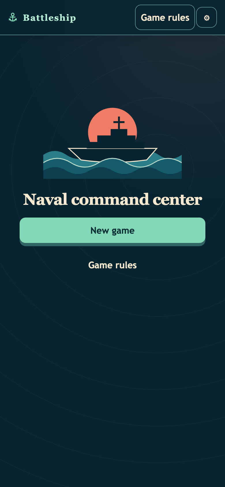
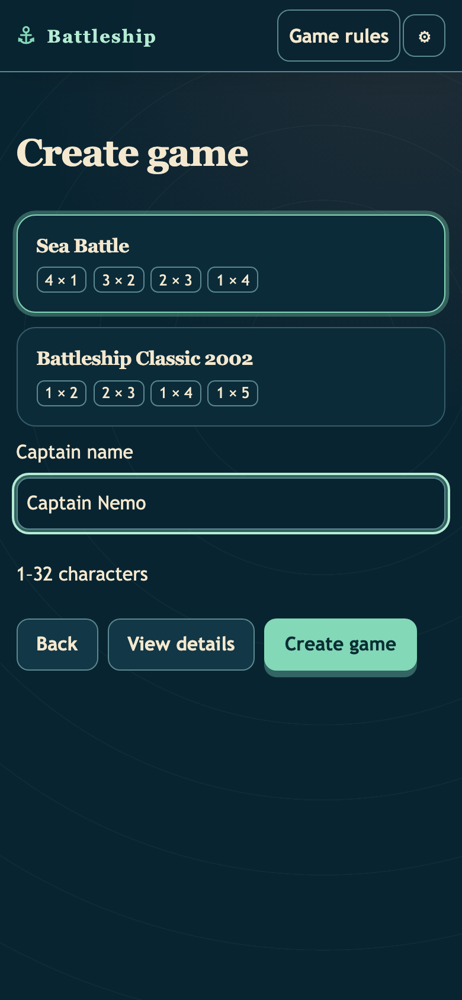
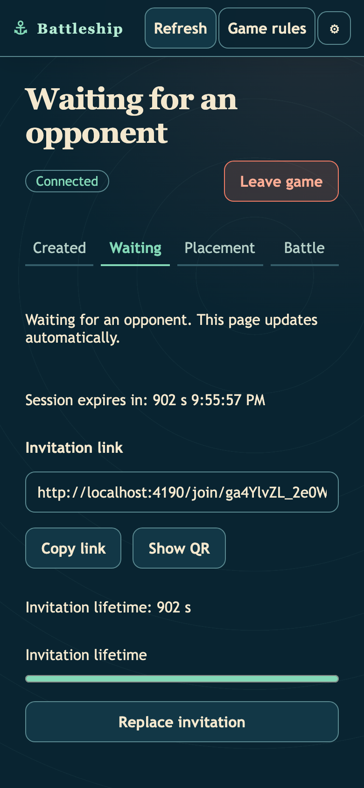
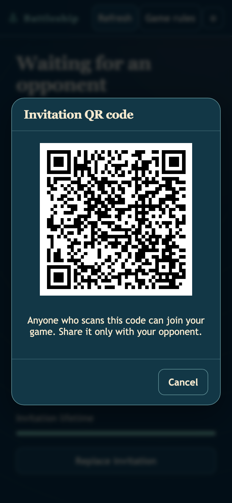
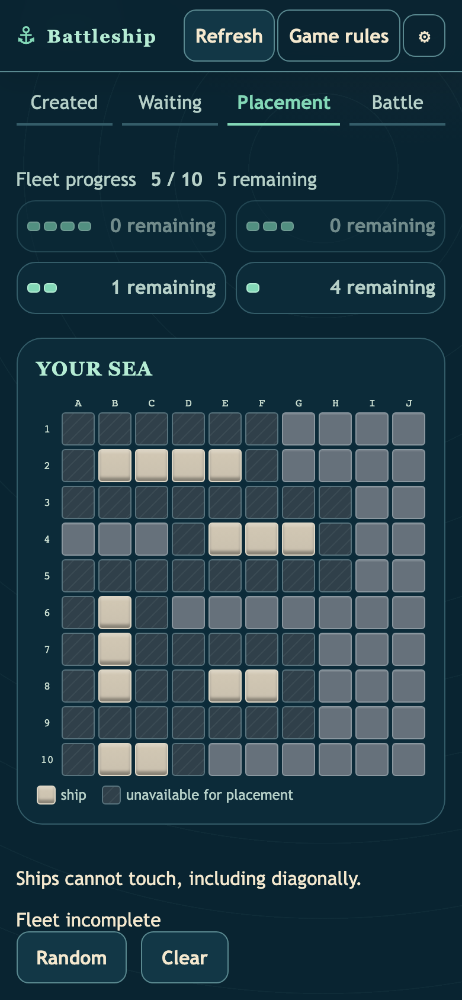
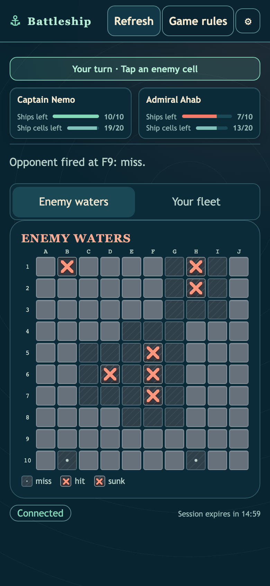
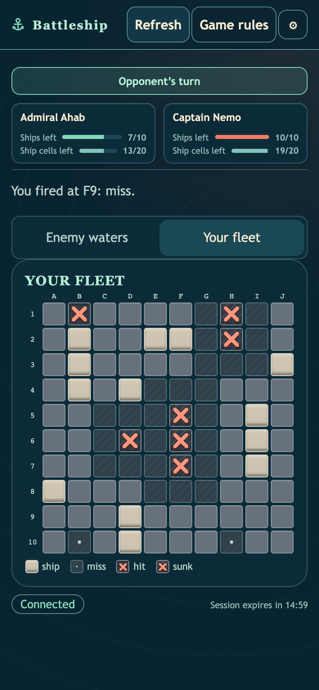
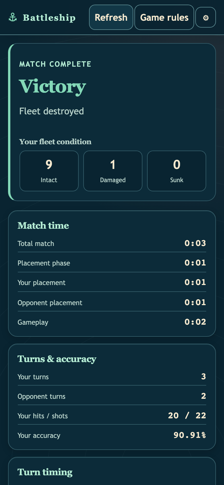
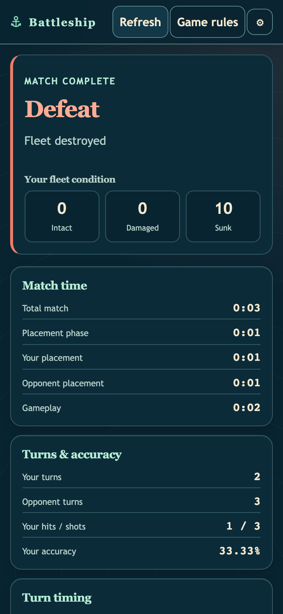

# Battleship

An online Battleship game for two players. One player creates a game and shares an invitation link or QR code, the other joins, both place their fleets and play live in the browser. No accounts, no ads, no tracking.

## Purpose

The goal is a simple, working online Battleship game that runs in a browser as plain static HTML, CSS and JavaScript on top of a small backend.

The project is also a learning exercise: the current code, tests and documentation were produced by AI agents, working from written specifications (spec-driven development). It is not meant to replace or compete with any other Battleship project or service.

### History

- **First version:** written entirely by hand as a pet project whose only goal was to work. It had no polished UI and little attention to design.
- **Rewrite:** built with AI agents using [GitHub Spec Kit](https://github.com/github/spec-kit), with a proper UI, a separate backend and frontend, and a shared API contract.
- **Since then:** the specifications were migrated to [OpenSpec](https://github.com/Fission-AI/OpenSpec), which is used for all further changes ([`openspec/`](openspec/)).

## Features

- Two players, anonymous: create a game, send the link (or show the QR code), play.
- Two rulesets: Sea Battle (10 ships) and Battleship Classic 2002.
- Phone-first layout; also works on desktop. English and Ukrainian, dark and light themes.
- The server owns the rules, turns and what each player may see; the opponent's board is never sent to the client.
- Live updates over Server-Sent Events. Games are kept in memory by design (see [Good to know](#good-to-know)).

## Architecture

Three independent parts that meet only at the API contract:

| Part | Path | What it is |
| --- | --- | --- |
| API contract | [`contracts/`](contracts/) | [`openapi.yaml`](contracts/openapi.yaml), the single source of truth for every request, response and example. Linted with Redocly. |
| Backend | [`backend/`](backend/) | Java 25, Spring Boot 4.1. Modules `domain` (rules, no Spring), `application` (use cases, in-memory state, per-player views) and `app` (HTTP, security, SSE). Wire DTOs are generated from the contract at build time. |
| Frontend | [`frontend/`](frontend/) | TypeScript, React and Vite. It only draws the snapshot the backend returns and enables the actions the backend allows. `npm run build` turns it into static HTML, CSS and JavaScript in `frontend/dist/`. |

The browser talks to one origin: a static web server serves the built UI and proxies `/api` to the backend, so there is no CORS. Commands are REST `POST`s; each player receives updates through one SSE stream.

```
Browser ──► static server (vite preview / nginx) ──► /api ──► Spring Boot backend ──► memory
              frontend/dist (HTML+CSS+JS)
```

Other directories: [`openspec/`](openspec/) (specifications, project rules and the history of changes), [`scripts/`](scripts/) (build, run and Docker scripts), [`config/`](config/) and [`Dockerfile`](Dockerfile) (container images), [`docs/`](docs/) (guides and screenshots). More detail: [docs/architecture.md](docs/architecture.md).

## Build locally

Requirements: Java 25 and Node.js 24, or only Docker.

```sh
./scripts/local-build.sh            # install exact dependencies, build everything, run all tests and checks
./scripts/local-build.sh --docker   # the same inside Docker, no local Java or Node needed
```

The script validates the contract, builds and tests the backend (producing `backend/app/target/battleship-app.jar`), builds and tests the frontend (`frontend/dist/`), and runs browser tests against the packaged backend. It takes about ten minutes; any failed or timed-out stage fails the run.

## Run locally

Play with the packaged build (after a successful build):

```sh
./scripts/local-deploy.sh localhost   # http://localhost:4173, this machine only
./scripts/local-deploy.sh             # HTTPS on your LAN address so phones can join
```

Open the printed URL in two separate browser sessions (a private window works) and create and join a game. On a LAN, install and trust the printed self-signed certificate on each device first.

### Development build with hot reload

Start the packaged backend, then the Vite dev server, which proxies `/api` to it:

```sh
BATTLESHIP_PUBLICBASEURL=http://localhost:5173 java -jar backend/app/target/battleship-app.jar
npm --prefix frontend run dev        # http://localhost:5173
```

The backend is not hot-reloaded: after changing backend code run `(cd backend && ./mvnw -DskipTests package)` and restart it. Run individual checks with `(cd contracts && npm run check)`, `(cd backend && ./mvnw -q verify)` and `(cd frontend && npm run check)`.

## Screens

Captured from the running application on a phone-sized viewport.

| | | |
| --- | --- | --- |
| <br>Home | <br>Create game | <br>Waiting for an opponent |
| <br>Invitation QR code | <br>Placing ships | <br>Gameplay: player to shoot |
| <br>Gameplay: player waiting | <br>Game over: winner | <br>Game over: loser |

## Documentation

- [Project guide](docs/index.md): game lifecycle, API, security, data and configuration.
- [Architecture](docs/architecture.md) and [developer guide](docs/development.md).
- [Local operation](docs/local-operation.md): scripts, Docker images, LAN setup, ports.
- [Render deployment](docs/render-deployment.md) and [CI](docs/ci.md): the single-image build and the GitHub Actions pipeline.
- [API contract guide](contracts/README.md), [product intent](docs/intent.md) and [specifications](openspec/specs/).

## Good to know

- Games and sessions are only in memory, on purpose: the game is meant to run either fully locally or on a free hosting tier, with minimal resources and no database or other service to run. The consequence is that restarting the backend ends every game.
- A game link is not a credential. A one-time secret in the link fragment is redeemed only when the guest presses Join.
- The backend is limited in games, streams, request sizes and rates; see [configuration](docs/configuration.md).
- `./scripts/build-docker-render.sh` builds one image (frontend and backend) for a manual deployment to Render. Nothing is pushed or deployed automatically from this repository except tagged releases to GitHub Container Registry.

## License

[MIT](LICENSE)
