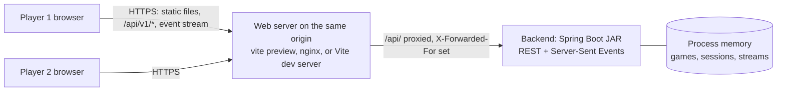
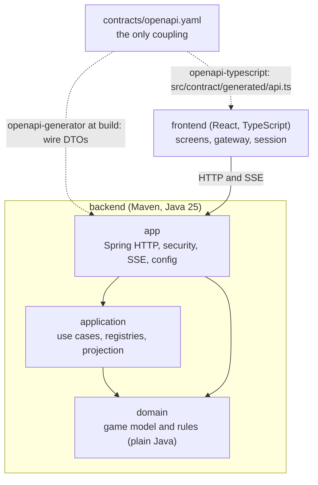
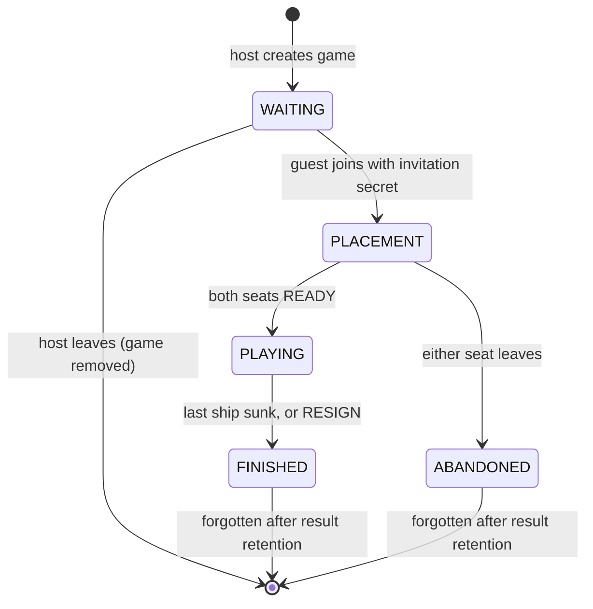
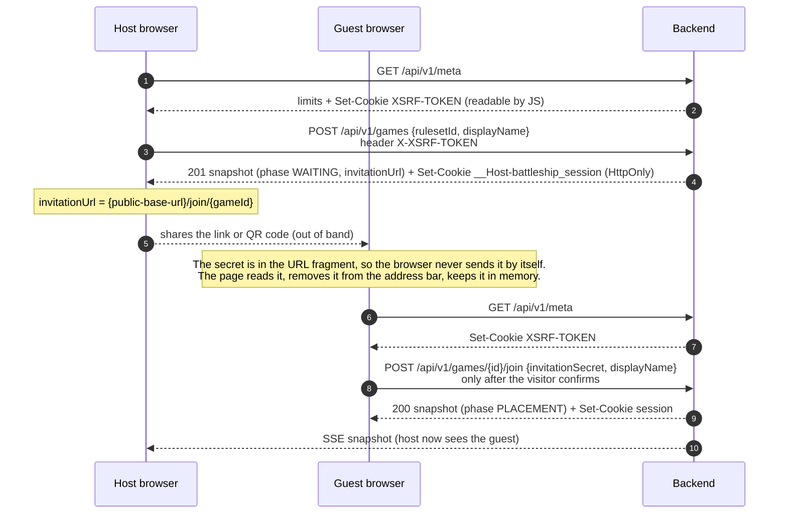
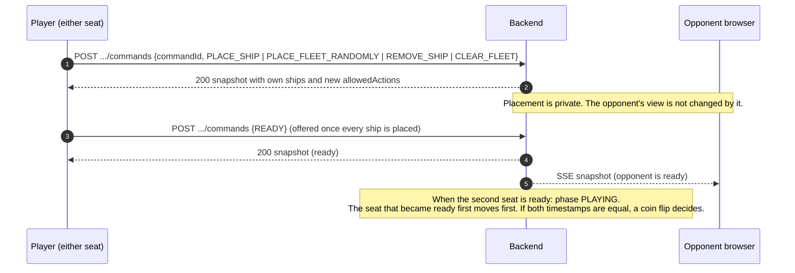
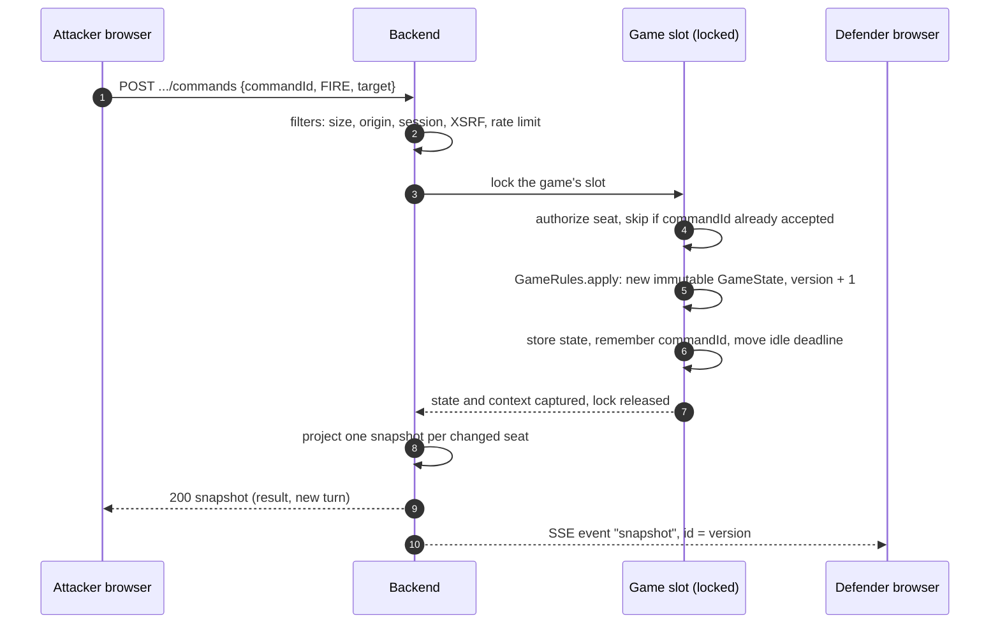
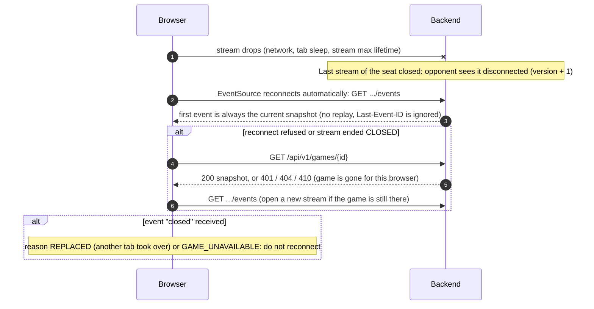
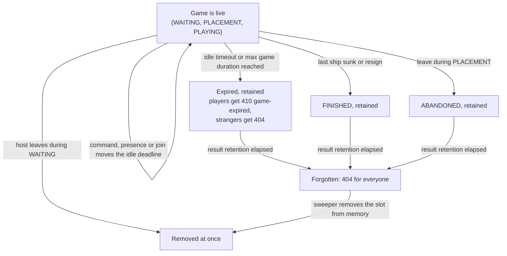

# Architecture

How the pieces fit together and how a game flows through them. For the product goals read [intent](intent.md); for the game rules and
the endpoint list read the [project guide](index.md); for the module internals, configuration and build commands read
the [backend guide](backend.md). The wire format is defined only by [`contracts/openapi.yaml`](../contracts/openapi.yaml).

## Purpose in one paragraph

Two anonymous players play Battleship in browsers. The **backend decides everything** (rules, turns, outcomes and what each
player may see). The **frontend only draws** the caller-relative snapshot the backend returns and enables the actions listed in
its `allowedActions`. The two meet only at the OpenAPI contract. Nothing is stored on disk: games live in the backend's memory.

## System context

- There is **no database, queue or external service**. Restarting the backend ends every game and session.
- The browser sees **one origin**. The web server serves the built UI and proxies `/api/` to the backend, so there is no CORS.
- Server-to-browser updates use one Server-Sent Events (SSE) stream per player; everything the player does is an ordinary POST.

## Modules and dependency rule

Dependencies point **inward** (`app` to `application` to `domain`), never back. Two mechanisms enforce it, so a wrong import fails the build:

- Maven Enforcer `bannedDependencies` in each module's `pom.xml` ([domain](../backend/domain/pom.xml), [application](../backend/application/pom.xml), [app](../backend/app/pom.xml)).
- [`ArchitectureTest`](../backend/app/src/test/java/ua/kostenko/battleship/app/ArchitectureTest.java) (ArchUnit): `domain` may not use Spring, Jackson, `jakarta`, `java.io`, logging, `Clock` or `Random`; `application` may not use Spring, Jackson or `jakarta`, nor `app`.

Consequence: rules and use cases run in plain unit tests, and the HTTP layer can change without touching them. Generated DTOs carry Jackson annotations, so they live in `app` and are filled from the framework-free `SnapshotView` of `application` ([details](backend.md#dto-generation)).

## Game phases and `allowedActions`

The server computes the set of actions each seat may perform right now ([`AllowedActions`](../backend/domain/src/main/java/ua/kostenko/battleship/domain/rules/AllowedActions.java)) and puts it in every snapshot. The UI enables exactly those. A command whose action is not in the set is refused with `action-not-allowed` before any rule runs.

Expiry is not a phase. A game in `WAITING`, `PLACEMENT` or `PLAYING` that reaches its idle timeout or maximum duration is *expired*: its players get `410 game-expired` for a while, then it is forgotten (see [flow 5](#5-expiry-and-abandon)).

| Phase | Host may | Guest may |
|---|---|---|
| `WAITING` | `NEW_INVITATION`, `SEND_PRESENCE`, `LEAVE` | nothing (no guest yet) |
| `PLACEMENT`, not ready | `PLACE_SHIP`, `REMOVE_SHIP`, `PLACE_FLEET_RANDOMLY`, `CLEAR_FLEET`, `SEND_PRESENCE`, `LEAVE`; plus `READY` once every ship is placed | same as host |
| `PLACEMENT`, ready | `SEND_PRESENCE`, `LEAVE` | same as host |
| `PLAYING` | the seat on turn: `FIRE`, `RESIGN`, `SEND_PRESENCE`; the other seat: `RESIGN`, `SEND_PRESENCE` | same as host |
| `FINISHED`, `ABANDONED` | `LEAVE` | `LEAVE` |

## Flows

### 1. Create a game, invite, join

- A link scanner that merely fetches the page cannot take the seat: the fragment never reaches the server and joining needs an explicit POST.
- The server stores only SHA-256 digests of the session value and of the invitation secret. The invitation is cleared when used, replaced, expired, or when the host leaves.
- Use cases: [`CreateGameUseCase`](../backend/application/src/main/java/ua/kostenko/battleship/application/usecase/CreateGameUseCase.java), [`JoinGameUseCase`](../backend/application/src/main/java/ua/kostenko/battleship/application/usecase/JoinGameUseCase.java).

### 2. Placement and ready

### 3. A shot

- The state change happens under a **per-game lock**; projecting and publishing happen **after** the lock is released.
- Replaying the same `commandId` (for example after a lost answer) applies nothing twice and returns the current snapshot.
- Both seats' views change on every accepted shot, so both streams receive a new snapshot with a higher `version`. Clients ignore any snapshot whose version is not newer.

### 4. Reconnect and recovery

Client rules (ordering by `version`, one command at a time, presence timer) are in the [contract guide](../contracts/README.md#client-rules). Server side: [SSE hub](backend.md#live-updates-sse-hub).

### 5. Expiry and abandon

Which answer a request gets depends only on deadlines compared at request time ([`ExpiryPolicy`](../backend/application/src/main/java/ua/kostenko/battleship/application/usecase/ExpiryPolicy.java)); the periodic sweeper only frees memory and closes streams. Durations are configurable: see the [configuration reference](backend.md#configuration-reference).

## Security model

| Concern | Mechanism | Where |
|---|---|---|
| Who is this browser? | Random 32-byte session value in cookie `__Host-battleship_session` (`HttpOnly`, `Secure`, `SameSite=Strict`, `Path=/`, no `Domain`). The server keeps only its SHA-256 digest. | [`SessionCookie`](../backend/app/src/main/java/ua/kostenko/battleship/app/web/SessionCookie.java), [`SessionRegistry`](../backend/application/src/main/java/ua/kostenko/battleship/application/registry/SessionRegistry.java) |
| Which seat in a game? | The game slot stores the digests of its host and guest sessions. Knowing a `gameId` grants nothing. A stranger gets `404 game-unavailable`, indistinguishable from a missing game. | [`GameSlot`](../backend/application/src/main/java/ua/kostenko/battleship/application/registry/GameSlot.java), [`ExpiryPolicy.authorize`](../backend/application/src/main/java/ua/kostenko/battleship/application/usecase/ExpiryPolicy.java) |
| Joining | One-time 32-byte invitation secret, compared as digests in constant time, delivered in the URL fragment. | [`JoinGameUseCase`](../backend/application/src/main/java/ua/kostenko/battleship/application/usecase/JoinGameUseCase.java) |
| Forged requests (CSRF) | Every unsafe request must echo the readable `XSRF-TOKEN` cookie in `X-XSRF-TOKEN`. Requests marked `Sec-Fetch-Site: cross-site` or `same-site`, or with an `Origin` other than the origin of `battleship.public-base-url`, are refused with 403. | [`SecurityConfig`](../backend/app/src/main/java/ua/kostenko/battleship/app/security/SecurityConfig.java), [`SiteIsolationFilter`](../backend/app/src/main/java/ua/kostenko/battleship/app/security/SiteIsolationFilter.java) |
| Hidden information | The opponent's ships are never sent, except hit and sunk cells, water the ruleset reveals around a sunk ship, and the whole board once `FINISHED`. Done in `SnapshotProjector`, not in the UI. | [`SnapshotProjector`](../backend/application/src/main/java/ua/kostenko/battleship/application/projection/SnapshotProjector.java) |
| Abuse | Per-operation rate limits (address for create and join, session for the rest), request body cap, caps on games, sessions, streams and live games per browser. | [backend guide](backend.md#rate-limiting) |
| Caching | Every response carries `Cache-Control: no-store`. | [`CacheControlFilter`](../backend/app/src/main/java/ua/kostenko/battleship/app/web/CacheControlFilter.java) |
| Browser hardening | The web server in front sets `Content-Security-Policy`, `Referrer-Policy: no-referrer`, `X-Content-Type-Options`, `X-Frame-Options: DENY`. | [`config/nginx-server.conf.template`](../config/nginx-server.conf.template), `securityHeaders` in [`frontend/vite.config.ts`](../frontend/vite.config.ts) |
| Client address | Per-player rate limits; the [trust model](configuration.md#x-forwarded-for-from-browser-to-rate-limit) says which proxy sets `X-Forwarded-For` and when the backend believes it. | [`nginx-server.conf.template`](../config/nginx-server.conf.template), [`RateLimitFilter`](../backend/app/src/main/java/ua/kostenko/battleship/app/security/RateLimitFilter.java) |
| Logs | Records carry a correlation id and the `gameId` only; never names, cookies, secrets, boards, bodies or addresses. | [backend guide](backend.md#logging) |

The session cookie needs a secure context, so the app must be opened over HTTPS or on `localhost`, and with exactly the URL configured as `battleship.public-base-url`.

## Deployment topologies

```mermaid
flowchart TB
    subgraph local ["scripts/local-deploy.sh (your machine / LAN)"]
        b1["Browser"] -->|"https://LAN-IP:4173 or http://localhost:4173"| v["vite preview<br/>static files + /api proxy"]
        v -->|"127.0.0.1:8080"| j1["java -jar battleship-app.jar"]
    end
    subgraph dev ["Frontend development"]
        b2["Browser"] -->|"http://localhost:5173"| vd["vite dev server<br/>hot reload + /api proxy"]
        vd --> j2["java -jar, started by hand"]
    end
    subgraph docker ["Docker images (scripts/build-docker-*.sh)"]
        b3["Browser"] -->|"your HTTPS in front"| n1["battleship-frontend<br/>nginx :8080"]
        n1 -->|"BATTLESHIP_BACKEND_UPSTREAM"| j3["battleship-backend :8080"]
    end
    subgraph render ["Render image (scripts/build-docker-render.sh)"]
        b4["Browser"] -->|"HTTPS"| re["Render edge"]
        re -->|"HTTP on PORT"| n2["nginx in the same container"]
        n2 -->|"127.0.0.1:8080"| j4["backend in the same container"]
    end
```

All topologies keep UI and API on one origin. Every one of them needs `BATTLESHIP_PUBLICBASEURL` to equal the URL typed in the browser. Single backend instance only, because state is in memory.

Commands, ports, certificates and troubleshooting: [local operation](local-operation.md). Building, pushing and running the Render image: [Render deployment](render-deployment.md). The `Dockerfile` stages are commented in [`Dockerfile`](../Dockerfile).
