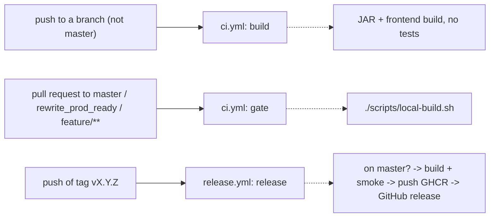

# Continuous integration and releases

Two workflows in [`.github/workflows/`](../.github/workflows/) reuse the repository's own entry points; no new scripts. The commands, images and ports are in [configuration](configuration.md); deploying the image on Render is in the [Render guide](render-deployment.md).



| Event | Runs | What it does |
| --- | --- | --- |
| Push to a branch other than `master` | `build` | `./mvnw -q -DskipTests package` and `npm ci` + `npm run build`: the same commands as the Dockerfile `jar` and `dist` stages. No tests. |
| Pull request to `master` (and, temporarily, `rewrite_prod_ready`, `feature/**`) | `gate` | `./scripts/local-build.sh`, the single product gate. On failure it uploads Playwright and Surefire/Failsafe reports for 7 days. |
| Push to `master` | nothing | `master` only advances through a PR whose gate was green. |
| Push of tag `vX.Y.Z` | `release` | Publishes the image and the GitHub release (below). Tag pushes never match the branch filters of `ci.yml`. |

**Duplicate runs.** A branch with an open PR triggers both the push event (`build`) and the PR event (`gate`). They are different jobs, so nothing is run twice for the same purpose; `build` is cheap and `gate` is the one that counts. Runs of one workflow for the same PR or branch cancel older ones.

The `rewrite_prod_ready` and `feature/**` pull-request targets exist only while the rewrite is unmerged; drop them from `ci.yml` afterwards.

## Cutting a release

1. Make sure the commit is on `master` and its PR `gate` was green.
2. Tag and push:

```sh
git switch master && git pull --ff-only
git tag -a vX.Y.Z -m "vX.Y.Z"
git push origin vX.Y.Z
```

The workflow rejects a tag that is not strict `vX.Y.Z` or whose commit is not an ancestor of `master`, builds the `render` image and runs `scripts/build-docker-render.sh --smoke` on it, then pushes `ghcr.io/<owner>/<repo>:X.Y.Z`, `:X.Y` and `:latest` (plain single-manifest `linux/amd64` image, no provenance or SBOM attestations; adding them is a Release-grade decision). The smoke build and the push build share one buildx builder, so the image is compiled once. The release page carries the image reference, the immutable `@sha256:` reference and the Render settings.

**Re-runs.** Re-running the workflow is safe: it re-pushes the same tags (same content) and edits the notes of an existing release instead of failing. Deleting or re-pointing a tag, deleting a release or a package version is manual and deliberate; prefer a new version.

## Using the image on Render

Take the image reference from the release page and follow [the Render guide](render-deployment.md) from step 3 (use the GHCR reference instead of Docker Hub). To deploy exactly one build, use the `@sha256:` reference. Set `BATTLESHIP_PUBLICBASEURL` to the exact https origin; Render supplies `PORT`. A private GHCR package needs a Render registry credential with a token that can read packages; otherwise make the package public.

## Repository settings (manual, once)

- Settings > Actions > General: workflow permissions read-only by default; require approval for fork pull requests. The workflows set their own `permissions`.
- GHCR package: after the first release, link it to the repository and choose its visibility (Packages > Package settings).
- Branch protection on `master`: require a pull request and the `gate` status check. Required checks only apply to PRs that target `master`, which is why `gate` runs for those.
- Optional: a tag ruleset restricting who may create `v*` tags.

## Assumptions and risks

- `release` does not re-run the gate: it trusts that the tagged commit passed the PR gate. A tag on a `master` commit that was never gated would be published; the smoke test is the only check.
- Browser journeys are not blanket-retried; a flaky journey is fixed, not hidden.
- SonarQube scans stay local ([local operation](local-operation.md)); Playwright browsers are not cached.
- Not verifiable without GitHub: the first real runs of both workflows, the GHCR push, and the link to the repository.

## Stays manual

Deploying on Render, GHCR package settings, branch protection, tag management, Sonar scans.
