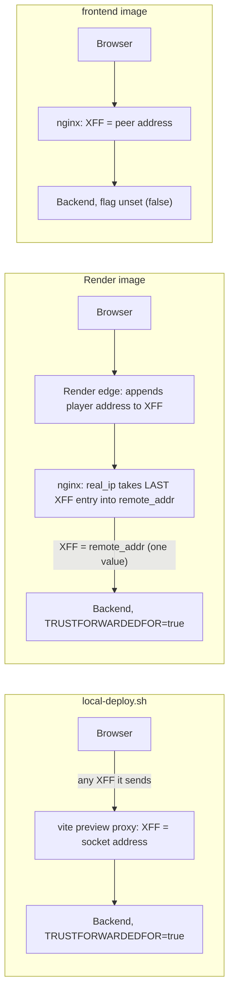
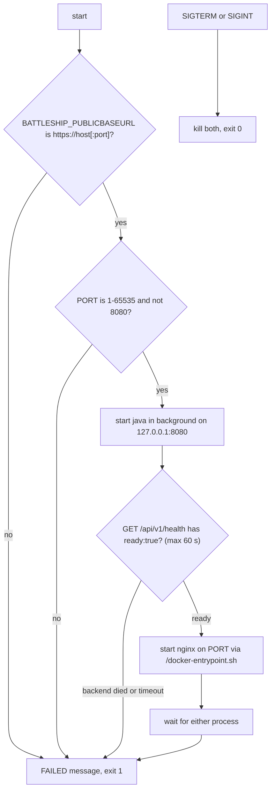
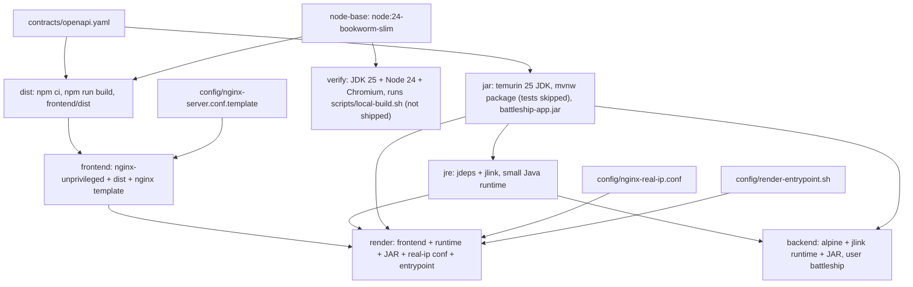
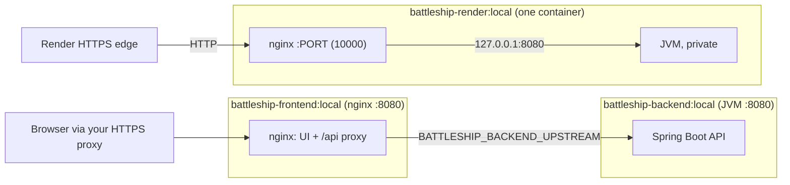

# Configuration, scripts and images

This page explains every file in [`config/`](../config/), every environment variable that scripts, images or the frontend tooling read, and how the five scripts and the [`Dockerfile`](../Dockerfile) fit together. Game rules and backend internals are in [backend](backend.md); the runtime shape of the system is in [architecture](architecture.md). Commands and troubleshooting are in [local operation](local-operation.md); the manual Render workflow is in the [Render guide](render-deployment.md).

| File in `config/` | Used by | Purpose |
| --- | --- | --- |
| [`nginx-server.conf.template`](../config/nginx-server.conf.template) | `frontend` and `render` images | The one nginx server block: static UI, `/api` proxy, security headers. |
| [`nginx-real-ip.conf`](../config/nginx-real-ip.conf) | `render` image only | Takes the player's address from Render's `X-Forwarded-For`. |
| [`render-entrypoint.sh`](../config/render-entrypoint.sh) | `render` image only | Validates settings, starts the backend and nginx in one container. |
| [`local.env.example`](../config/local.env.example) | People running local commands | Documented defaults of the local ports and backend settings. |

## `nginx-server.conf.template`

One server block shared by both nginx-based images, so the UI is served identically in each.

**How it becomes live config.** The `frontend` stage copies it to `/etc/nginx/templates/default.conf.template`. The official nginx image's entrypoint runs `envsubst` on templates at start-up and writes `/etc/nginx/conf.d/default.conf`, replacing only `${PORT}` and `${BATTLESHIP_BACKEND_UPSTREAM}` from the container environment. Every other `$name` in the file (`$http_host`, `$remote_addr`, `$uri`) is an nginx variable and is left alone.

### Server-level directives

| Directive | What and why |
| --- | --- |
| `listen ${PORT};` | Port nginx listens on: 8080 in the `frontend` image (set by `ENV PORT=8080`), 10000 in the `render` image (Render overrides it). The image is the unprivileged nginx, so the port must be above 1023. |
| `server_name _;` | Catch-all name: the container answers for whatever host name reaches it. |
| `root /usr/share/nginx/html;` | Where the `frontend` stage copies the built `dist/`. |
| `access_log off;` | No per-request access log (the file does not state why). |

### Security headers

Set with `add_header ... always;` at **server level on purpose**: an `add_header` inside a `location` replaces all inherited ones for that location, so keeping them here guarantees every response (static files, SPA fallback and proxied API answers) carries all four. `always` adds them to error responses too. The same values are applied by `vite preview` (`securityHeaders` in [`vite.config.ts`](../frontend/vite.config.ts)); keep the two in step.

| Header | Value | Why |
| --- | --- | --- |
| `Content-Security-Policy` | see next table | Limits what the page can load or run to its own origin. |
| `Referrer-Policy` | `no-referrer` | Links and requests from the app never reveal the page URL (which contains the game id) to another site. |
| `X-Content-Type-Options` | `nosniff` | Browsers must honour the declared content type and may not guess scripts out of other files. |
| `X-Frame-Options` | `DENY` | The app cannot be framed (click-jacking). Old-browser twin of `frame-ancestors 'none'`. |

The CSP, directive by directive:

| Directive | Meaning | Why |
| --- | --- | --- |
| `default-src 'self'` | Fallback for every fetch type not listed below: scripts, `fetch`/XHR, `EventSource`, service worker, manifest, fonts, media. | Everything is same-origin: bundle, API, event stream, service worker and manifest. No third-party host is allowed anywhere. |
| `style-src 'self'` | Stylesheets only from files on this origin. | No `<style>` elements or inline stylesheets. |
| `style-src-attr 'unsafe-inline'` | Allows `style="..."` attributes only. | React sets inline style attributes (for example in `Board` and `ShipActionDialog`). This relaxes attributes only; `<style>` elements and all scripts stay blocked. |
| `img-src 'self' data:` | Images from this origin and `data:` URLs. | The bundler inlines small images as `data:` URLs. |
| `object-src 'none'` | No plugins or `<object>`/`<embed>`. | Nothing uses them. |
| `base-uri 'none'` | `<base>` is not allowed. | Stops an injected `<base>` from redirecting relative URLs. |
| `form-action 'self'` | Forms can only submit to this origin. | Defence in depth; the app uses `fetch`. |
| `frame-ancestors 'none'` | Nobody may embed the page. | Click-jacking protection; unlike `X-Frame-Options` it is the modern form. |

There is no `script-src`, so scripts fall back to `default-src 'self'`: no inline scripts and no `eval`.

### Revalidated files

`/index.html`, `/sw.js` and `/manifest.webmanifest` keep fixed names, so a browser that cached them would never see a new release. They are sent with `Cache-Control: no-cache` (store, but revalidate on every use); everything under `/assets/` is content-hashed. A `map` on `$uri` yields `no-cache` for these three paths and an empty value (no header) otherwise, and one **server-level** `add_header Cache-Control` applies it, so the four security headers above stay on every response; a per-location `add_header` would have dropped them. Deep links fall back to `/index.html` internally, so they are covered too. `vite preview` already sends `no-cache` for its files. The browser journeys (`smoke.spec.ts`) and `build-docker-render.sh --smoke` assert the header together with the security headers.

### `location /api/`

Everything under `/api/` goes to the backend.

| Directive | What and why |
| --- | --- |
| `proxy_pass ${BATTLESHIP_BACKEND_UPSTREAM};` | The private backend base URL, e.g. `http://127.0.0.1:8080` (render image) or `http://backend:8080`. No trailing path, so the request URI is passed unchanged. |
| `proxy_http_version 1.1;` | Needed for keep-alive upstream connections and streaming responses. |
| `proxy_set_header Host $http_host;` | Passes the `Host` header exactly as the browser sent it (including the port), so the backend sees the public host. |
| `proxy_set_header X-Forwarded-For $remote_addr;` | **Replace, never append.** See [X-Forwarded-For](#x-forwarded-for-from-browser-to-rate-limit). |
| `proxy_set_header Connection "";` | Clears the hop header so upstream connections stay open (required with HTTP/1.1 upstream keep-alive). |
| `proxy_hide_header X-Content-Type-Options;` and `X-Frame-Options` | The backend sends these two itself. Hiding its copies leaves each header once, with the nginx value. |
| `proxy_buffering off;` | Server-sent events must reach the browser as they are written, not when a buffer fills. |
| `proxy_cache off;` | Nothing from the API is cached by nginx. |
| `proxy_read_timeout 1h;` | nginx closes an upstream connection after 60 s of silence by default; one hour comfortably exceeds the stream maximum lifetime (1200 s by default), and heartbeats arrive every 15 s by default. |

### `location /`

`try_files $uri $uri/ /index.html;` serves a real file when one exists and otherwise the app shell, so a deep link such as `/games/abc` or `/join/abc` loads the single-page app, which then routes on the client.

## X-Forwarded-For: from browser to rate limit

The backend rate-limits by client address. By default it uses the TCP peer address; with `BATTLESHIP_TRUSTFORWARDEDFOR=true` it uses the **last** `X-Forwarded-For` entry instead (the one appended by the proxy next to it; earlier entries are client-controlled and ignored). That is only safe when a single trusted proxy is the backend's only caller and overwrites the header.

| Setup | What the backend receives | Trust flag | Result |
| --- | --- | --- | --- |
| `local-deploy.sh` | `vite preview` overwrites `X-Forwarded-For` with the connecting socket's address | `true`, set by the script on the Java command | Per-player limits. |
| `render` image | nginx overwrites `X-Forwarded-For` with `$remote_addr`, which `nginx-real-ip.conf` set to the last entry Render's edge appended | `true`, set in `render-entrypoint.sh` | Per-player limits, assuming Render's edge appends the address (not verified on a real Render service). |
| `frontend` image + your backend | nginx overwrites `X-Forwarded-For` with the address it sees | not set by the image, default `false` | The backend limits by nginx's own address, so all players behind that nginx share the create and join limits. Set `BATTLESHIP_TRUSTFORWARDEDFOR=true` on the backend yourself only if nginx is its only caller. |

## `nginx-real-ip.conf`

Copied into the render image as `/etc/nginx/conf.d/00-real-ip.conf`, so it is included at `http` level before `default.conf` and its directives apply to the server block (ngx_http_realip_module).

| Line | What and why |
| --- | --- |
| `set_real_ip_from 0.0.0.0/0;` and `::/0;` | Trust every source address (IPv4 and IPv6) to supply the real address. Safe here only because Render's edge is the only thing that can reach the container. |
| `real_ip_header X-Forwarded-For;` | Take the client address from this header. |
| (absent) `real_ip_recursive` | Left off (nginx default), so nginx uses the **last** address in the header, the one Render's edge appended, not the first, which the client could forge. |

nginx then rewrites `$remote_addr` to that address, and the server block forwards it as the single `X-Forwarded-For` value.

## `render-entrypoint.sh`

The render image runs two processes (nginx and the JVM) in one container. This script is the entrypoint; it is plain `sh` (Alpine), strict (`set -eu`).

| Lines | What and why |
| --- | --- |
| 4 | `set -eu`: stop on any error and on any unset variable. |
| 6 | `fail()` prints `FAILED: ...` to stderr and exits 1, so Render's logs show why the container stopped. |
| 8-9 | `BATTLESHIP_PUBLICBASEURL` must match `^https://[A-Za-z0-9][A-Za-z0-9.-]*(:[0-9]{1,5})?$`: HTTPS, a host, an optional port, and no trailing slash, path, query or credentials. The backend compares this value with the request `Origin`; a wrong value would make every state-changing request fail with 403, so the container refuses to start instead. |
| 10-11 | `PORT` must be numeric, 1-65535, and not 8080, which is reserved for the private backend. (`PORT` defaults to 10000 in the image.) |
| 13-18 | `stop()` removes the traps, sends SIGTERM to the backend and nginx and waits; the trap on `TERM`/`INT` calls it and exits 0, so a Render stop is a clean shutdown (the backend drains gracefully). |
| 20-22 | Starts the JVM in the background: `SERVER_PORT=8080` and `SERVER_ADDRESS=127.0.0.1` keep it private behind nginx; `BATTLESHIP_TRUSTFORWARDEDFOR=true` is safe because nginx is the only caller and overwrites the header; `-XX:MaxRAMPercentage=75` lets the JVM use most of the container's memory while leaving room for nginx and non-heap memory. |
| 24 | `proxy=$backend` makes `stop` valid before nginx exists. |
| 26-32 | Polls the health endpoint every 0.5 s for at most 120 attempts (about 60 s) until it contains `"ready":true`; fails fast if the JVM exits. nginx is not started earlier, so Render never routes traffic to a half-started app. The image's `HEALTHCHECK` start period (75 s) is longer than this window. |
| 34-37 | Hands over to the nginx image's own `/docker-entrypoint.sh`, which fills the config template from the environment and runs nginx in the foreground (`daemon off`). |
| 39-42 | `wait -n` returns when either process exits; the script stops the other and fails, so the container exits non-zero and Render restarts it. |

## `local.env.example`

A documented list of defaults, **not loaded automatically**: export the variables you want before running `local-deploy.sh` (the JVM inherits the environment). The file is an example of names and default values only; no secret belongs in it.

| Names | Default | Meaning |
| --- | --- | --- |
| `FRONTEND_PORT`, `BACKEND_PORT` | 4173, 8080 | Ports of `vite preview` (web) and the backend; see [Variables](#environment-variable-reference). |
| `BATTLESHIP_IDLETIMEOUTSECONDS` | 900 | Idle lifetime of a game. |
| `BATTLESHIP_MAXGAMEDURATIONSECONDS` | 7200 | Maximum game duration. |
| `BATTLESHIP_RESULTRETENTIONSECONDS` | 300 | How long a finished game stays readable. |
| `BATTLESHIP_INVITATIONLIFETIMESECONDS` | 900 | Invitation validity. |
| `BATTLESHIP_PRESENCEINTERVALSECONDS` | 300 | Presence interval the client is told to use (via `GET /meta`). |
| `BATTLESHIP_HEARTBEATSECONDS` | 15 | Interval of event-stream heartbeats. |
| `BATTLESHIP_STREAMMAXLIFETIMESECONDS` | 1200 | Maximum life of one event stream. |
| `BATTLESHIP_MAXCONCURRENTGAMES`, `...STREAMS` | 100, 200 | Capacity limits. |
| `BATTLESHIP_MAXLIVEGAMESPERBROWSER` | 1 | Live games one browser may hold. |
| `BATTLESHIP_MAXREQUESTBODYBYTES` | 16384 | Request body limit. |
| `BATTLESHIP_RANDOMARRANGEMENTATTEMPTS` | 1000 | Attempts for random fleet placement. |
| `BATTLESHIP_SWEEPINTERVALSECONDS` | 30 | Expiry-cleanup interval. |
| `BATTLESHIP_SHUTDOWNDRAINSECONDS` | 5 | Graceful shutdown drain time. |
| `BATTLESHIP_PUBLICBASEURL` | (commented) | Deliberately unset: `local-deploy.sh` sets it from the URL it prints. |
| `BATTLESHIP_RATELIMIT_*PERMINUTE` | create 5, join 20, commands 60, read 120, presence 30, stream open 30, replace invitation 10, leave 10 | Per-client request limits per fixed 60-second window. |

The names are Spring relaxed-binding forms of the `battleship.*` properties in [`application.yaml`](../backend/app/src/main/resources/application.yaml) (`battleship.idle-timeout-seconds` becomes `BATTLESHIP_IDLETIMEOUTSECONDS`), validated by `BattleshipProperties` (every number must be at least 1). The same rule gives names for properties the example omits, which keep their `application.yaml` defaults: `BATTLESHIP_MAXCONCURRENTSESSIONS` (200), `BATTLESHIP_STREAMRETRYAFTERSECONDS` (1), `BATTLESHIP_RATELIMIT_TABLECAPACITY` (10000) and `BATTLESHIP_TRUSTFORWARDEDFOR` (false). Because the example and `application.yaml` are separate copies, check the YAML when they appear to disagree; the YAML is authoritative.

## Environment variable reference

Only variables that exist in the scripts, `Dockerfile`, `config/` or tool configuration are listed.

| Variable | Read by | Default and where set | Meaning |
| --- | --- | --- | --- |
| `PORT` | nginx template, `render-entrypoint.sh`, image health checks | `ENV PORT=8080` in `frontend`; `ENV PORT=10000` in `render` | Port nginx listens on. In `render` it must be 1-65535 and not 8080. |
| `BATTLESHIP_PUBLICBASEURL` | backend; `backend` image entrypoint; `render-entrypoint.sh`; `local-deploy.sh`; e2e stacks | `http://localhost:5173` in `application.yaml`; required (no default) in `backend` and `render` images; set by `local-deploy.sh` and by each e2e stack | Exact browser origin. State-changing requests whose `Origin` differs fail with 403. Must be `https://` in `render`. |
| `BATTLESHIP_BACKEND_UPSTREAM` | nginx template | `http://127.0.0.1:8080` in `render`; **required, no default** in `frontend` | Private backend base URL for `proxy_pass`. |
| `BATTLESHIP_TRUSTFORWARDEDFOR` | backend | `false`; `true` set by `local-deploy.sh` and `render-entrypoint.sh` | Use the last `X-Forwarded-For` entry as the client address for rate limits. |
| `SERVER_PORT` | Spring Boot | `ENV SERVER_PORT=8080` in `backend`; 8080 in `render-entrypoint.sh`; `$BACKEND_PORT` in `local-deploy.sh`; per stack in e2e | Backend listen port. |
| `SERVER_ADDRESS` | Spring Boot | `127.0.0.1` in `render-entrypoint.sh` and `local-deploy.sh`; unset in `backend` | Backend bind address (private behind a proxy). |
| `BATTLESHIP_*` (other) | backend | `application.yaml` defaults | See [`local.env.example`](#localenvexample). |
| `FRONTEND_PORT` | `vite.config.ts` (preview), `local-deploy.sh`, e2e fixture | 4173 | Port of `vite preview`. |
| `BACKEND_PORT` | `vite.config.ts` (proxy target), `local-deploy.sh`, e2e fixture | 8080 | Backend port used as proxy target and, in `local-deploy.sh`, as `SERVER_PORT`. |
| `FRONTEND_HOST` | `vite.config.ts` | unset means `127.0.0.1`; `local-deploy.sh` sets `0.0.0.0` for a LAN address | Bind address of `vite preview`. |
| `FRONTEND_TLS_CERT`, `FRONTEND_TLS_KEY` | `vite.config.ts` | set by `local-deploy.sh` for a LAN address (paths in `.local-tls/<IP>/`) | Serve `vite preview` over HTTPS. |
| `LOCAL_BUILD_STAGE_TIMEOUT` | `local-build.sh` | 1800 seconds; must be a positive integer | Per-stage time limit of the gate. |
| `BROWSER_COVERAGE` | `vite.config.ts`, e2e fixture | unset; `1` set by `npm run test:browser-coverage` | Unminified build with hidden source maps and Chromium coverage capture. |
| `VITE_BUILD_ID` | frontend settings dialog | unset, shown as `local` | Build label; no script sets it. |

Java options are not environment variables: the images and scripts pass `-XX:MaxRAMPercentage=75` on the command line (`backend` entrypoint and `render-entrypoint.sh`).

## Scripts and images

### Why five scripts

| Script | Exists to | Variables it sets or reads |
| --- | --- | --- |
| [`local-build.sh`](../scripts/local-build.sh) | Be the single product gate: runtime check, exact installs, contract, backend, frontend, browser journeys. `--docker` runs the same script inside the `verify` stage so no local Java or Node is needed. | Reads `LOCAL_BUILD_STAGE_TIMEOUT`. Exports nothing; the journeys set their own stack variables. |
| [`local-deploy.sh`](../scripts/local-deploy.sh) | Run the packaged app on one origin so phones on the LAN can play. | Exports `BACKEND_PORT`, `FRONTEND_PORT`, `BATTLESHIP_PUBLICBASEURL`; for a LAN IP also `FRONTEND_HOST`, `FRONTEND_TLS_CERT`, `FRONTEND_TLS_KEY`. Starts Java with `BATTLESHIP_TRUSTFORWARDEDFOR=true`, `SERVER_PORT`, `SERVER_ADDRESS=127.0.0.1`. |
| [`build-docker-frontend.sh`](../scripts/build-docker-frontend.sh) | Build the nginx image (UI plus `/api` proxy) as `battleship-frontend:local`. | None at build time. Run needs `BATTLESHIP_BACKEND_UPSTREAM`. |
| [`build-docker-backend.sh`](../scripts/build-docker-backend.sh) | Build the API-only image as `battleship-backend:local`. | None at build time. Run needs `BATTLESHIP_PUBLICBASEURL`. |
| [`build-docker-render.sh`](../scripts/build-docker-render.sh) `[--smoke] [image:tag]` | Build the combined `linux/amd64` image (`battleship-render:local` by default) and optionally smoke-test it. | None for the build. `--smoke` runs containers as described [below](#build-docker-rendersh---smoke). |

All scripts `cd` to the repository root first, so they work from any directory, and all use `set -euo pipefail`.

**`local-build.sh` step by step.** Parse `--docker` (then `exec docker build --target verify --tag battleship-verify:local .`) or reject other arguments; validate the timeout; define `stage`, which runs a command as a background job in its own process group with a watchdog that sends TERM, then KILL, to the whole group after the timeout (so Maven, Node and browsers all stop); run the six stages in order, each failing the run by name on a non-zero exit or a timeout.

### `local-deploy.sh` step by step

1. Pick the host: the argument, or the LAN address (`ipconfig getifaddr en0` on macOS, `hostname -I` on Linux); only `localhost` or an IPv4 address is accepted.
2. Choose the URL: `http://localhost:$FRONTEND_PORT`, or `https://<IP>:$FRONTEND_PORT` plus a self-signed OpenSSL certificate (30 days, `subjectAltName=IP:<IP>`, key created with `umask 077`) in the git-ignored `.local-tls/<IP>/`, regenerated when expired. The session cookie is `Secure`, so a LAN origin needs HTTPS.
3. Set `BATTLESHIP_PUBLICBASEURL` to that URL, refusing a different pre-set value. The backend accepts a state-changing request only when its `Origin` equals this value byte for byte, so the browser must use exactly the printed URL (another host name, or `127.0.0.1` instead of `localhost`, fails with 403).
4. Build the JAR and `frontend/dist` only when missing.
5. Start the JVM (private, `127.0.0.1:$BACKEND_PORT`, default 8080) with `BATTLESHIP_TRUSTFORWARDEDFOR=true`, wait for health (up to 120 tries of 0.5 s; if it never becomes ready or dies, the script stops it and fails with a message), then start `vite preview` on `$FRONTEND_PORT` (default 4173). `vite preview` binds `127.0.0.1` for `localhost` and all interfaces (`FRONTEND_HOST=0.0.0.0`) for a LAN address; it serves `dist/`, falls back to the shell for deep links and proxies `/api` and the event stream, so the browser sees one origin.
6. Print the URL; keep running until either process stops, and kill both on exit.

### `build-docker-render.sh --smoke`

Owner of the list of smoke checks. After building, the script verifies the image architecture is `amd64` (always, with or without `--smoke`), then with `--smoke` starts containers on loopback port `18081` (which must be free; the containers are removed afterwards) and checks that the image:

1. refuses `PORT=8080` and a non-HTTPS `BATTLESHIP_PUBLICBASEURL`, with a clear message and before anything listens;
2. becomes healthy on a non-default port (`/api/v1/health` reports `"ready":true`);
3. runs as a non-root user;
4. answers a deep link with the SPA shell;
5. sends the four security headers, and `Cache-Control: no-cache` for `/`, `/sw.js` and `/manifest.webmanifest`.

It does not validate public HTTPS, browser cookies, gameplay or Render's proxy, so an HTTP-only local smoke test is not a substitute for a public HTTPS browser test.

### Dockerfile stages

All images are built from the repository root inside Docker. Base images are pinned by tag and digest. The stages that do not depend on the CPU (`node-base`, `dist`, `jar`) run on `$BUILDPLATFORM`, so an amd64 image built on an Apple-silicon machine does not emulate Maven or npm; `jre` runs on the target CPU because it produces native code.

| Stage | Why it exists |
| --- | --- |
| `node-base` | The single place Node 24 is pinned; `dist` builds on it and `verify` copies Node from it. |
| `dist` | Builds `frontend/dist`. Copies the contract (types are generated from it) and the package files first, so the slow `npm ci` layer is reused when only code changes. |
| `jar` | Builds `battleship-app.jar` with tests skipped (tests belong to `verify`); copies the contract because DTOs are generated from it. |
| `jre` | Cuts a Java runtime down to the modules the JAR needs: `jdeps` lists them from the JAR and its libraries, `jlink` builds the runtime (plus `jdk.unsupported`, loaded reflectively by some libraries). Far smaller than a full JRE image. |
| `verify` | The whole gate in Docker: JDK 25 base, Node copied from `node-base`, Chromium and its system libraries cached by package files, then `./scripts/local-build.sh`, the same script as locally, so the two cannot drift. Nothing is shipped from it. |
| `frontend` | Unprivileged nginx (non-root, port 8080) with `dist` and the nginx template; health check fetches `/`. |
| `backend` | Plain Alpine with the jlink runtime and the JAR, non-root user `battleship` (uid 10001), port 8080. The shell-form entrypoint stops with a message unless `BATTLESHIP_PUBLICBASEURL` is set, then `exec`s Java so it receives signals. Health check: `/api/v1/health` contains `"ready":true`. |
| `render` | Starts `FROM frontend` (so it reuses the same nginx layers), adds the runtime, the JAR, `00-real-ip.conf` and the entrypoint, sets `PATH`, `PORT=10000` and `BATTLESHIP_BACKEND_UPSTREAM=http://127.0.0.1:8080`. Health check start period is 75 s. |

### Image topology

Use the `frontend` and `backend` images together when you want two containers behind your own HTTPS; use `render` for a single-container deployment. None of the images terminates HTTPS and nothing is pushed or deployed by the scripts; publishing and the Render service are manual (see the [Render guide](render-deployment.md)).
