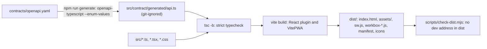
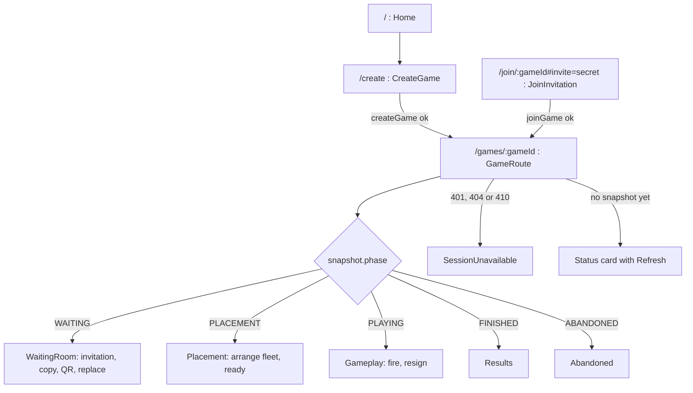
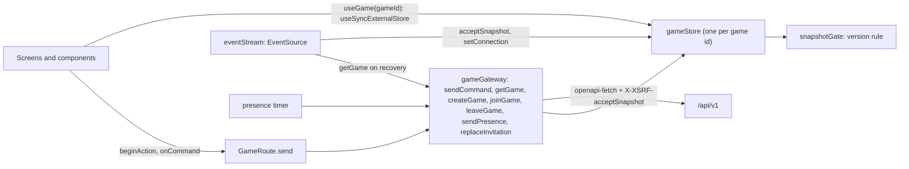
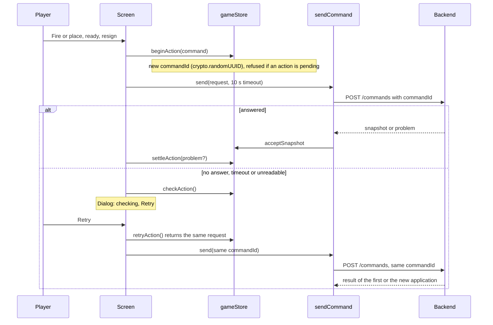
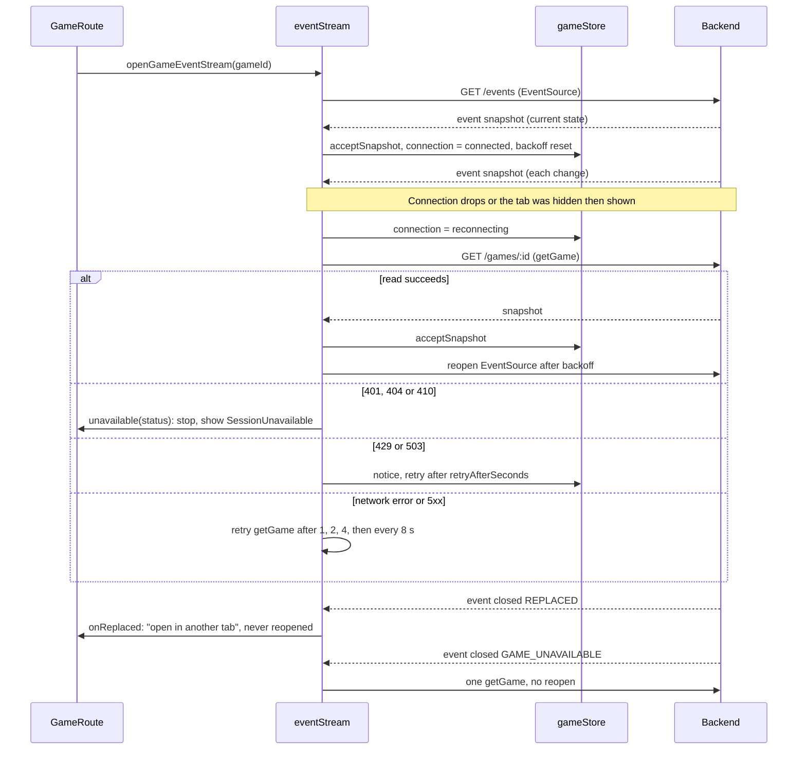

# Frontend

The frontend is a React 19 single-page application written in TypeScript and built with Vite. It owns presentation only: the backend decides rules, turns and what each player may see, and the frontend enables controls from the snapshot's `allowedActions`. For the system as a whole see [architecture](architecture.md); for the server side see [backend](backend.md); for wire fields see the [contract guide](../contracts/README.md).

Everything lives in [`frontend/`](../frontend/). Source is in [`frontend/src/`](../frontend/src/), unit tests in [`frontend/tests/`](../frontend/tests/), browser journeys in [`frontend/e2e/`](../frontend/e2e/).

## Build pipeline

Step by step:

1. **Generate types.** `npm run generate` runs `openapi-typescript ../contracts/openapi.yaml --enum-values -o src/contract/generated/api.ts`. The output is a `.ts` file (not `.d.ts`) because `--enum-values` also emits runtime arrays such as `phaseValues` and `actionValues`, which [`gateway/decode.ts`](../frontend/src/gateway/decode.ts) uses to validate server data. It is never committed or hand-edited. Every script that reads `src/` has a `pre` script that runs it first: `predev`, `prebuild`, `pretypecheck`, `prelint`, `pretest`, `pretest:coverage`. `e2e` has none.
2. **Typecheck.** `tsc -b` follows [`tsconfig.json`](../frontend/tsconfig.json) to `tsconfig.app.json` (covers `src` and `tests`) and `tsconfig.node.json` (tool configuration). The options are strict, with `noUncheckedIndexedAccess`, `exactOptionalPropertyTypes`, `noUnusedLocals` and `noUnusedParameters`. This is why optional props are spread conditionally in the source (`{...(x === undefined ? {} : { x })}`).
3. **Bundle.** `vite build` ([`vite.config.ts`](../frontend/vite.config.ts)) uses `@vitejs/plugin-react` and `vite-plugin-pwa`. The plugin generates the service worker (see [PWA](#pwa-and-service-worker)). With `BROWSER_COVERAGE=1` the build is unminified and emits hidden source maps; this is only for `npm run test:browser-coverage`.
4. **Check the output.** [`scripts/check-dist.mjs`](../frontend/scripts/check-dist.mjs) scans every file in `dist/` and fails on `localhost:`, `127.0.0.1` or `:8080`, so a development address cannot ship.

Dependency installs use [`.npmrc`](../frontend/.npmrc): `legacy-peer-deps=true` is needed because `openapi-typescript` 7 declares a TypeScript 5 peer while TypeScript 6 is pinned. Run npm from `frontend/` so the file applies. Versions are exact, and the Node engine is `>=24 <25`.

### Commands

All run from `frontend/` (or as `npm --prefix frontend ...`).

| Command | What it does |
| --- | --- |
| `npm run generate` | Regenerate contract types. |
| `npm run dev` | Vite dev server with hot reload on `http://localhost:5173`. Needs a backend started by hand. |
| `npm run build` | Generate, typecheck, bundle into `dist/`. |
| `npm run typecheck`, `lint`, `format:check`, `format` | Individual quality checks (`format` rewrites files). |
| `npm test` | Vitest unit and component tests (jsdom). `test:coverage` adds V8 coverage. |
| `npm run check` | `format:check`, `lint`, `typecheck`, `test`, `build`, then `check-dist.mjs`. This is the frontend stage of the [product gate](local-operation.md#build-and-test-local-buildsh). |
| `npm run e2e` | Playwright journeys. Needs the JAR (`backend/app/target/battleship-app.jar`) and `dist/` from an earlier `npm run build` or `check`. |
| `npm run test:browser-coverage` | Unminified build plus all journeys, merged into `coverage/lcov.info` (supplementary, see [SonarQube](local-operation.md#local-sonarqube-analysis)). |

ESLint ([`eslint.config.js`](../frontend/eslint.config.js)) enforces the architecture: outside `src/gateway/` and `src/preferences/`, the globals `fetch`, `EventSource` and `localStorage` are errors. All network and storage access therefore goes through the gateways. In `e2e/`, `route.fulfill` is an error so journeys cannot fake the backend.

## Same origin and the dev proxy

The browser only ever talks to its own origin, so the backend needs no CORS. [`gateway/client.ts`](../frontend/src/gateway/client.ts) creates the `openapi-fetch` client with `baseUrl: ''` and `credentials: 'same-origin'`. Three servers provide that single origin:

| Server | Used for | Source of the proxy |
| --- | --- | --- |
| `vite` (dev server) | Hot reload on `localhost:5173`. | `server.proxy` in `vite.config.ts` |
| `vite preview` | The packaged build locally (`local-deploy.sh`, browser journeys) on `FRONTEND_PORT` (4173). | `preview.proxy` and `preview.headers` |
| nginx | Docker images. | [`config/nginx-server.conf.template`](../config/nginx-server.conf.template), see [configuration](configuration.md) |

Both Vite servers share one `apiProxy`: `/api` goes to `http://127.0.0.1:$BACKEND_PORT`, and the proxy overwrites `X-Forwarded-For` ([trust model](configuration.md#x-forwarded-for-from-browser-to-rate-limit)). Only `preview` sends the security headers, so the CSP is not enforced under `npm run dev`. `preview` binds `127.0.0.1` (or `FRONTEND_HOST`), uses `strictPort`, and serves HTTPS when `FRONTEND_TLS_CERT` and `FRONTEND_TLS_KEY` are set (`local-deploy.sh` does this for LAN addresses). The dev server's origin `http://localhost:5173` matches the backend's default `BATTLESHIP_PUBLICBASEURL`, so state-changing requests pass the origin check out of the box.

## Routes and screens

Routing is a small custom module ([`app/router.ts`](../frontend/src/app/router.ts)): `getRoute(pathname)` parses four path shapes, and `navigate()` calls `history.pushState` then dispatches `popstate`. [`App.tsx`](../frontend/src/app/App.tsx) reads the path with `useSyncExternalStore`. Any other path renders Home. nginx and `vite preview` return `index.html` for unknown paths, so deep links work.

- **Shell.** [`Shell`](../frontend/src/app/Shell.tsx) and `Header` persist across routes. The header opens the rules dialog (`listRulesets` on demand) and the settings dialog. On game routes it also shows the ruleset title and a Refresh button; Resign lives in the settings dialog while `RESIGN` is allowed.
- **Game route.** [`GameRoute.tsx`](../frontend/src/screens/GameRoute.tsx) loads meta, rulesets and the game in parallel, opens the event stream, starts presence, and picks the screen from `snapshot.phase`. The screen is derived from server data on every render; no screen state outlives a phase change. Leaving is a confirmation dialog in WAITING and PLACEMENT (`LeaveControl`).
- **Invitation.** The secret travels in the URL fragment, which browsers never send to servers. [`stripInvitationSecret()`](../frontend/src/session/inviteSecret.ts) runs in `main.tsx` before React renders: on `/join/...#invite=...` it moves the secret into a module variable and rewrites the address bar without the fragment. Joining needs the visitor's name and an explicit click (so link scanners cannot claim a seat). The secret is cleared after a join or a definite `invitation-unavailable`/expired answer, and kept after other refusals and after an unknown outcome so the visitor can retry.
- **Remembered game.** The id of the caller's current game is stored in `localStorage` (`battleship.currentGameId`) only to offer "return to your game" (Home, and when a create or join is refused with `browser-game-limit`). It is cleared on 401/404/410 and after leaving. It is not a way to recover a game; the session cookie is.

## State model

Components never call `fetch`. They read one store per game and call gateway functions, which write to that store.

[`session/gameStore.ts`](../frontend/src/session/gameStore.ts) keeps, per game id (a `Map`, created on demand):

| Field | Meaning |
| --- | --- |
| `snapshot` | The latest accepted caller-relative `GameSnapshot`. |
| `meta`, `clockOffsetMs` | `GET /meta` data; offset between server time and the local clock, refreshed from every snapshot and meta read. Countdowns use server times corrected by this offset and never decide expiry. |
| `connection` | `connected`, `reconnecting` or `offline`. |
| `action`, `checking` | The single in-flight command and whether its outcome is unknown (see below). |
| `notice` | Last problem to show, with `retryAtMs` computed from `retryAfterSeconds`. |

**One version gate.** Every snapshot source (command answer, `getGame`, presence, invitation replacement, SSE) goes through [`snapshotGate.accept`](../frontend/src/session/snapshotGate.ts): a higher `version` replaces the snapshot, a lower one is dropped, and an equal one only updates `expiresAt`, `serverTime`, `invitationUrl` and `invitationExpiresAt`, the fields the contract excludes from `version`. A late response therefore cannot overwrite newer state.

**Decoding.** [`gateway/decode.ts`](../frontend/src/gateway/decode.ts) rejects a body unless the content type is JSON, it parses, and every required snapshot key and nested shape is present; unknown `allowedActions` values are dropped. A failure throws `TransportFailure` and nothing reaches the store. This checks readability, not the whole schema.

### Commands, command ids and retry

- There is **one action slot per game**. `beginAction` creates a `commandId` and returns `undefined` if a command is already pending, so controls are also disabled while `action` is set.
- A command with no answer within 10 seconds is aborted (`AbortSignal.timeout(10_000)`). A network failure, abort or unreadable answer is an *unknown outcome*: the slot enters `checking` and a non-dismissible dialog offers Retry. Retry resends the **same** `commandId`, which the server uses to return the first result instead of applying the command twice (the idempotency contract; see [contract guide](../contracts/README.md)).
- The slot settles only on that action's own HTTP answer. An SSE snapshot updates the board but leaves a lost action in `checking`.
- A definite problem answer (`GatewayError`) settles the slot and shows a notice. A `409` also triggers `getGame` so the board matches the server; `401/404/410` trigger a reload that lands on the unavailable screen.
- Create is different: a `createGame` that ends in an unknown outcome is shown as `create.unknown` and never resent automatically, and a join with an unknown outcome keeps the secret and shows `join.unknown`.

### Anti-forgery

The contract requires every `POST` to echo the `XSRF-TOKEN` cookie in `X-XSRF-TOKEN`; `GET /meta` is the anti-forgery setup call. Every gateway write calls `getMeta()` first (cached), and a request interceptor in `client.ts` copies the cookie into the `X-XSRF-TOKEN` header for each `POST`. If a request is refused with `request-security-rejected`, the gateway refreshes meta once and resends that request once.

### Errors and problems

[`gateway/problems.ts`](../frontend/src/gateway/problems.ts) decodes `application/problem+json` (status must match, `code` must be present, `retryAfterSeconds` must be a positive integer) and maps `code` to a translation key through a `Record<ProblemCode, MessageKey>`, so removing a code from the contract fails the typecheck. Unknown codes fall back by status (401, 403, 404, 410, 422, 429, 503, 5xx, otherwise malformed). `429` and `503` show a calm wait message; `retryAtMs` disables Refresh, Retry and fire controls until it passes, with no automatic retry for user actions. The wider contract is in the [contract guide](../contracts/README.md). A render error is caught by [`ErrorBoundary`](../frontend/src/app/ErrorBoundary.tsx), and an offline browser shows [`OfflineBanner`](../frontend/src/components/OfflineBanner.tsx) and disables actions.

## Live updates (SSE)

[`gateway/eventStream.ts`](../frontend/src/gateway/eventStream.ts) owns one `EventSource` at a time for `/api/v1/games/:id/events`. The browser sends the session cookie itself. The server sends the current snapshot first, then a snapshot per change plus periodic heartbeats that trigger no client handler; there is no replay with `Last-Event-ID`, so recovery always means "read the game again".

Rules that matter:

- Opening a new stream closes the previous one, and callbacks from a superseded stream are ignored (`stream !== next`, a `generation` counter for recovery).
- Backoff is 1, 2, 4, 8 s (then 8 s), reset by the first received snapshot, so a refused stream open cannot loop quickly.
- Going offline (`offline` event or `navigator.onLine` false) closes the stream and sets `connection = 'offline'`; coming back online or returning from a hidden tab runs the recovery read and reopens.
- `closed` with `REPLACED` means the same browser opened the game elsewhere (a second tab). The stream is left closed and screens disable actions (`streamReplaced`).
- A snapshot that fails to decode sets `reconnecting` and is not applied.

### Presence

[`session/presence.ts`](../frontend/src/session/presence.ts) sends `POST /presence` every `limits.presenceIntervalSeconds` (from `GET /meta`) while the tab is visible, the connection is `connected`, and the snapshot allows `SEND_PRESENCE`. It uses one timer that is not restarted by store updates, is re-armed on visibility changes, and swallows failures. Presence extends game expiry on the server; it does not use the action slot.

## PWA and service worker

Configured in `vite.config.ts` (`registerType: 'prompt'`, `injectRegister: false`, `manifest: false`; the manifest is the static [`public/manifest.webmanifest`](../frontend/public/manifest.webmanifest) linked from `index.html`):

- **What is cached.** The generated worker precaches the build output and routes navigations to `index.html` (`navigateFallback`). **Nothing else is cached: no `runtimeCaching` is configured, so API responses and the event stream are never cached.** `navigateFallbackDenylist: [/^\/api\//]` keeps `/api` navigations away from the shell. `cleanupOutdatedCaches` removes old precaches.
- **Registration.** [`registerPwa`](../frontend/src/pwa/registerPwa.ts) is wrapped by `createDeferredPwaGateway` and runs after the window `load` event, so it never competes with first paint.
- **Updates.** A new worker waits (prompt mode). `UpdatePrompt` shows "update available" with *Update now* (`updateSW(true)`, which reloads) or *Dismiss*. A game is never reloaded without the player asking.
- **Install.** [`installGateway`](../frontend/src/pwa/installGateway.ts) captures `beforeinstallprompt`; the settings dialog shows an install button only while an install is available.
- **Offline.** The shell loads offline, but play does not: the app shows the offline banner and disables commands. Offline play and queued commands are non-goals (see [intent](intent.md)).

## Internationalisation

Catalogs are [`i18n/en.ts`](../frontend/src/i18n/en.ts) and [`i18n/uk.ts`](../frontend/src/i18n/uk.ts) (English and Ukrainian). `MessageKey` is the key set of the English catalog, so a missing English key is a compile error, and `tests/i18nParity.test.ts` checks the two catalogs match. `useT()` reads the locale from preferences. Keys starting `ruleset.` and `ship.` come from server ids; if a catalog lacks them the raw id is shown. The locale is not detected from the browser: the default is English until the player changes it. The `<html lang>` attribute follows the locale.

## Preferences

[`preferences/preferences.ts`](../frontend/src/preferences/preferences.ts) holds one store in `localStorage` under `battleship.preferences`, validated on read (any invalid value yields the defaults) and synchronised across tabs through the `storage` event. All storage access goes through `storageGateway`, which turns every storage failure (private mode, blocked storage) into a result instead of an exception.

| Preference | Values | Default |
| --- | --- | --- |
| `locale` | `en`, `uk` | `en` |
| `theme` | `dark`, `light`, `system` | `dark` |
| `emoji` | boolean | `false` |
| `sound` | boolean | `true` |
| `haptics` | boolean | `false` |

`themeController` sets `data-theme` on `<html>` from the preference and follows `prefers-color-scheme` when it is `system`. Only preferences and the remembered game id are stored in the browser; the build id shown in settings is `VITE_BUILD_ID` or `local` (no script sets it).

## Feedback: audio, haptics, QR

- **Audio.** [`feedback/audioFeedback.ts`](../frontend/src/feedback/audioFeedback.ts) synthesises sounds with the Web Audio API from recipes in `audioRecipes.ts` (oscillator tones and deterministic noise); there are no audio files. The context is created lazily, unlocked by the player's first fire click (browser autoplay rules), and resumed when the tab becomes visible.
- **Haptics.** `navigator.vibrate` with a pattern per result (miss, hit, sunk), wrapped so a missing or failing API cannot affect play.
- **When.** `useShotFeedback` plays feedback when a *new* `lastShot` arrives and only if the matching preference is on; a shot already present when the screen mounts is not replayed.
- **QR.** [`Qr`](../frontend/src/components/Qr.tsx) lazy-loads the `qrcode` package and draws the invitation URL on a 256 px canvas (error correction level M) in the browser, so the secret is not sent to any QR service. On failure the canvas is hidden and an alert is shown. On screen the secret part of the link is masked (`#invite=••••••••`); the copy button copies the full URL.

## Accessibility

- The board is an ARIA `grid` with a roving `tabindex` and arrow-key navigation; each cell's label is its coordinate and state in words, so state is not colour-only. Marks are drawn as text symbols and hidden from assistive technology.
- [`Announcer`](../frontend/src/components/Announcer.tsx) is a polite live region that reads each new shot ("You fired B4: hit.").
- Dialogs use the native `<dialog>` element with `showModal()`; the "checking" dialog is non-dismissible.
- `prefers-reduced-motion` is respected in the base styles and the board.
- Pointer dragging of ships is not started for touch input; `ShipActionDialog` offers ship actions as an alternative to dragging.
- Journeys in `e2e/accessibility.spec.ts` run axe (`@axe-core/playwright`) across surfaces, sizes and themes.

## CSP implications

The CSP (see [configuration](configuration.md#nginx-serverconftemplate)) allows only same-origin scripts and styles. Consequences for code:

- No inline `<script>`, no inline `<style>` elements, no third-party hosts. Stylesheets must be files.
- React sets `style=""` attributes (for example on `Board` and `ShipActionDialog`), so the policy has `style-src-attr 'unsafe-inline'`. It relaxes attributes only; `<style>` elements and scripts stay blocked.
- Small images may be inlined by the bundler as `data:` URLs, so `img-src` allows `data:`.
- The service worker, manifest, API calls and event stream are same-origin and covered by `default-src 'self'`.

The same header values are applied by nginx and by `vite preview`, but not by `vite` (dev).

## Test strategy

| Layer | Tool | Where | What it proves |
| --- | --- | --- | --- |
| Unit and component | Vitest 5, jsdom, Testing Library | [`frontend/tests/`](../frontend/tests/) | Router, decoder, snapshot gate, store, gateway, event stream, presence, preferences, PWA gateways, feedback, i18n parity and individual components. |
| Browser journeys | Playwright (Chromium, one worker) | [`frontend/e2e/`](../frontend/e2e/) | Create, invite, join, place, play, results, leaving, lifetime, offline, recovery, settings and accessibility, against the **real packaged backend JAR**. |

There is no fake backend, recorded game data or mock engine. [`e2e/fixtures/stack.ts`](../frontend/e2e/fixtures/stack.ts) starts `java -jar backend/app/target/battleship-app.jar` and `vite preview` as child processes per stack (the same shape as `local-deploy.sh`), waits for health, writes logs to `e2e/.logs/`, and stops them afterwards. The default stack uses 4173 (web) and 8080 (backend) with high rate limits; journeys that need short lifetimes, low limits or a backend restart start their own stack on other ports (4174-4176 with 8081-8083, and 4193-4201 with 8193-8201), configured only through the existing `BATTLESHIP_*` settings. Lost answers are simulated with `page.route` that forwards to the real server (`route.fetch()`) or aborts; `route.fulfill` is forbidden by lint. The journeys serve `frontend/dist`, so run a build first, and free the listed ports before running them. The product gate runs both layers: see [local operation](local-operation.md).
