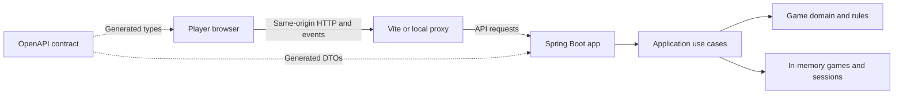

# Battleship project guide

Battleship lets two people play a browser-based naval guessing game. One player creates a game and shares a private invitation; each places ships and takes turns firing. The backend is authoritative: it validates actions and sends each player only the information they are allowed to see.

This guide describes the code in this repository. It is the table of contents; each topic has one home.

| Read | For |
| --- | --- |
| [Intent](intent.md) | Why the application exists, principles and non-goals. |
| [Architecture](architecture.md) | How the pieces fit together at runtime. |
| [Backend](backend.md) | Modules, game rules, security and live updates on the server. |
| [Frontend](frontend.md) | Build pipeline, screens, state, live updates, PWA, tests. |
| [Contract guide](../contracts/README.md) and [`openapi.yaml`](../contracts/openapi.yaml) | Exact request and response fields, examples and compatibility rules. |
| [Configuration, scripts and images](configuration.md) | Every file in `config/`, all environment variables, the Dockerfile stages. |
| [Developer guide](development.md) | Code map, change workflow, checks and debugging. |
| [Local operation](local-operation.md) | Running the gate and the LAN deployment, ports, SonarQube, failures. |
| [CI pipeline](ci.md) | GitHub Actions: branch build, PR gate, tag release to GHCR. |
| [Render deployment](render-deployment.md) | The manual public image workflow. |

## Architecture

The browser loads the React application and communicates with the API on the same origin, so no CORS is configured. Locally, `vite preview` serves the built files and proxies `/api`; in the Docker images, Nginx does. See [architecture](architecture.md), [frontend](frontend.md#same-origin-and-the-dev-proxy) and [configuration](configuration.md).

There is no database, message broker or external game service in the application runtime. Games, sessions and live subscriptions are process-local. Restarting the backend loses them, including after a Render restart or redeploy. A Render service must run as one instance for players to share that state. The browser stores preferences and a current game ID, not a recoverable server-side game. There are no scheduled business jobs or consumed message queues; the backend does schedule expiry cleanup and stream heartbeats. Build tools and optional local SonarQube are development dependencies, not game services.

## How a game works

1. The host chooses a ruleset and creates a game. The server establishes or reuses a session and returns a caller-relative snapshot containing the invitation while the game is waiting.
2. The host shares the invitation. The guest's browser extracts the secret from the URL fragment, removes it from the address bar and keeps it in memory; joining requires the visitor's confirmation. The server checks the invitation and establishes or reuses the guest session.
3. During **PLACEMENT**, both players arrange their fleets privately. A player can place or remove ships, randomize or clear the fleet, then mark a complete fleet ready. Once both are ready, play begins.
4. During **PLAYING**, the player whose turn it is fires at the opponent's board. The ruleset determines turn and reveal behavior. A player can resign. Destroying a fleet or resigning ends the game in **FINISHED**.
5. Leaving while waiting removes the game; leaving during placement results in **ABANDONED**. Terminal and expired games have bounded retention; restart also removes games. A finished game reveals both boards, whereas an abandoned game does not.

The two built-in rulesets use 10×10 boards. Sea Battle uses ten ships, disallows touching, grants another turn on a hit and reveals surrounding water when a ship sinks. Hasbro Classic uses five ships, allows touching and does neither of those extra reveals/turns. See [`Rulesets.java`](../backend/domain/src/main/java/ua/kostenko/battleship/domain/rules/Rulesets.java) and the rules returned by the API for the precise fleet and settings.

The server supplies `allowedActions` with each snapshot. The frontend enables actions from that list; it may offer placement hints, but the server validates commands. During play the opponent's unhit placement is hidden. [`GameRules`](../backend/domain/src/main/java/ua/kostenko/battleship/domain/rules/GameRules.java) implements game rules; the application snapshot projector builds the caller's view.

## Requests, responses and live updates

All API paths start with `/api/v1`. The contract defines payload fields, required cookies, status codes and examples; it is the source of truth for clients.

| Method and path | Purpose |
| --- | --- |
| `GET /meta` | Public metadata, limits and anti-forgery setup. |
| `GET /rulesets` | Published rules and fleets. |
| `GET /health` | Service health. |
| `POST /games` | Create a game and host session. |
| `GET /games/{gameId}` | Read the caller's current snapshot. |
| `POST /games/{gameId}/join` | Join using an invitation. |
| `POST /games/{gameId}/commands` | Submit a placement, ready, fire or resign command. |
| `GET /games/{gameId}/events` | Subscribe to server-sent game snapshots. |
| `POST /games/{gameId}/invitation` | Replace an invitation. |
| `POST /games/{gameId}/presence` | Report player presence. |
| `POST /games/{gameId}/leave` | Leave a game. |

Controllers are in [`backend/app/.../web`](../backend/app/src/main/java/ua/kostenko/battleship/app/web). A command enters a controller, is validated and passed to an application use case, which applies domain rules and projects a snapshot for the caller. A successful change can also publish snapshots to subscribed players. An event stream starts with the current snapshot; it does not replay events using `Last-Event-ID`.

The frontend side (version ordering, command retry with the same `commandId`, stream recovery, `closed` events) is described in [frontend](frontend.md#state-model); the server side in [backend](backend.md).

## Identity, privacy and failure

A game ID alone is not authentication. Create and join establish an `HttpOnly` session cookie; the backend checks the player's membership before returning game data. State-changing requests use the `XSRF-TOKEN` cookie and `X-XSRF-TOKEN` header, and must satisfy the configured same-origin policy. Use HTTPS or localhost for the secure session cookie. There is no CORS configuration for cross-origin clients. See [`security`](../backend/app/src/main/java/ua/kostenko/battleship/app/security) and the [contract security notes](../contracts/README.md#privacy-and-security).

Invalid or disallowed commands return an error rather than changing the game. The API defines problem responses and recovery behavior in the contract. A missing or expired game, lost session, or backend restart can make a game unavailable; the client cannot restore it from local storage. Invitation expiry requires a new invitation. Limits on body size, concurrent games and streams, and request rates protect the local service; the exact limits are configuration, not client-side rules.

## Data model

A **ruleset** describes board and fleet rules. A **game** contains phase, players, boards and turn. A **session** associates a browser with a player. A **snapshot** is a versioned, caller-relative representation, including `you`, `opponent`, visible boards and `allowedActions`. A **command** is a player intent with a `commandId`; it is not a replacement for server state. See the schemas and examples in [`openapi.yaml`](../contracts/openapi.yaml) for field-level definitions. The backend owns game state; the contract owns its wire representation.

Backend defaults are in [`application.yaml`](../backend/app/src/main/resources/application.yaml), bound and validated by [`BattleshipProperties`](../backend/app/src/main/java/ua/kostenko/battleship/app/config/BattleshipProperties.java). The `BATTLESHIP_*` overrides, ports and every other variable are listed in [configuration](configuration.md#environment-variable-reference). No secret store is configured by this repository. `scripts/local-deploy.sh` keeps its self-signed LAN certificate and key in the git-ignored `.local-tls/` directory; see [local operation](local-operation.md#run-it-on-your-lan-local-deploysh).

## Ownership

Ownership and a public support contact are not identified in repository configuration.
