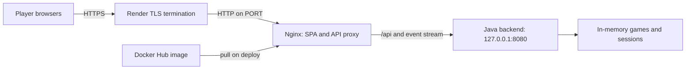

# Build and deploy the combined image on Render

This guide builds the application locally as a `linux/amd64` Docker image, publishes it to Docker
Hub, and runs that image as a Render web service. The repository does not push or deploy it
implicitly. (A `vX.Y.Z` tag on `master` also publishes the same image to GHCR through GitHub Actions; see
[CI pipeline](ci.md). That image can be used in Render instead of a Docker Hub image; deploying to Render stays
manual.) Replace `YOUR_USERNAME`, `VERSION`, and `YOUR-SERVICE` below with your own values.
The public deployment has not been verified on Render by the repository's local smoke test; follow
the post-deployment checks below.

## How it works and what it contains



The `render` stage in the root [Dockerfile](../Dockerfile) is one small Alpine image: the unprivileged
Nginx image (non-root, no curl or package manager use at run time), a Java 25 runtime trimmed with `jlink` to the
modules the backend needs, the packaged backend and the built frontend. The JDK, Maven and Node
are used only in separate build stages. Nginx serves static files and SPA deep links, sends the security headers
(CSP, `Referrer-Policy`, `X-Content-Type-Options`, `X-Frame-Options`) and proxies `/api/` and unbuffered
server-sent events to the private backend. Render terminates public HTTPS and forwards HTTP to Nginx.

The image entrypoint requires `BATTLESHIP_PUBLICBASEURL` to be the exact browser HTTPS origin. It
waits for the backend health endpoint before opening the proxy and stops both processes on shutdown.
Render supplies `PORT`, which defaults to `10000`; the image rejects invalid ports and `8080`, which
is reserved for the private backend. The JVM runs with `-XX:MaxRAMPercentage=75`. Docker's `EXPOSE`
metadata is not a port mapping. See the [entrypoint](../config/render-entrypoint.sh) and the
[Nginx configuration](../config/nginx-server.conf.template).

**Operational limits:** use one instance. Games, sessions and subscriptions are stored in memory;
restart, redeploy, spin-down or replacement loses active games. Multiple instances do not share
state. A disk does not persist this in-memory state. Per-player rate limits rely on Render's edge appending the player's address (unverified on a real Render
service); see the [X-Forwarded-For trust model](configuration.md#x-forwarded-for-from-browser-to-rate-limit). Other
capacity and lifetime defaults are described in [configuration](configuration.md#localenvexample).

## Prerequisites

- Docker CLI with Buildx and a running Docker daemon; the selected Docker context must point to it.
  Check with `docker context show`, `docker info`, and `docker buildx version`.
- A builder capable of `linux/amd64` builds. On Apple Silicon, an ARM Colima or Docker Desktop VM can
  use AMD64 emulation; emulated compilation can be slower. Start your existing Colima profile with
  `colima start` if you use it, and check `docker context ls` / `docker context show` to confirm which
  daemon the Docker CLI uses. Docker Desktop is another option. Do not delete an existing Colima
  profile to enable this workflow. If the build fails due to missing emulation, consult
  [Docker's multi-platform build documentation](https://docs.docker.com/build/building/multi-platform/)
  and the configuration of your selected builder.
- A Docker Hub account and a repository in the namespace you can push to; a Render account for the
  deployment. A private repository needs a Render registry credential with pull access.
- For the product gate, Java 25 and Node 24 (see [local operation](local-operation.md#requirements)) or
  `./scripts/local-build.sh --docker`. The image build compiles in Linux build stages (on your machine's own
  CPU, so no emulation for Maven or npm) and uses the repository root as its context. It skips tests; run the
  product gate separately before release.

## 1. Build and verify locally

From the repository root, first run the product gate, then build the image with the Docker Hub tag:

```sh
./scripts/local-build.sh
./scripts/build-docker-render.sh --smoke docker.io/YOUR_USERNAME/battleship:VERSION
docker image inspect docker.io/YOUR_USERNAME/battleship:VERSION --format '{{.Os}}/{{.Architecture}}'
```

The final command should print `linux/amd64`, which Render requires. The build script uses
`docker buildx build --platform linux/amd64 --target render --load` and loads the result into the
active daemon's local image store; it does **not** push. Without an argument its tag is
`battleship-render:local`. Use unique release tags and retain earlier images for rollback. The image
contains the files in the checkout at build time, including any uncommitted changes not excluded by
[.dockerignore](../.dockerignore); check `git status --short` if the build needs to match a commit.

`--smoke` (used above) starts the built image and removes it again, on loopback port `18081` (it must be free). It
checks that the image is `linux/amd64`, refuses `PORT=8080` and a non-HTTPS `BATTLESHIP_PUBLICBASEURL`, runs as a
non-root user, answers health on a non-default port, falls back to the SPA shell for deep links and sends the security
headers. It does not validate public HTTPS, browser cookies, gameplay, or Render's proxy. Secure cookies and
exact-origin checks mean an HTTP-only local smoke test is not a substitute for a public HTTPS browser test.

## 2. Push to Docker Hub

```sh
docker login
docker push docker.io/YOUR_USERNAME/battleship:VERSION
```

Use Docker's interactive login flow; do not place passwords or tokens in shell commands, files in
this repository, or documentation. Confirm the tag appears in the intended Docker Hub repository.
For a private repository, add a Docker Hub credential in Render with a token allowed to read that
image. Render also needs registry access later if it restarts or reschedules an instance or rolls
back, so retain both the image and working credentials. Render documents
[image credentials and image requirements](https://render.com/docs/deploying-an-image).

If you already built the default local tag, create the additional tag without rebuilding, then
push it:

```sh
docker tag battleship-render:local docker.io/YOUR_USERNAME/battleship:VERSION
docker push docker.io/YOUR_USERNAME/battleship:VERSION
```

Use a fresh build when the source has changed.

## 3. Create the Render web service

1. Open the [Render dashboard](https://dashboard.render.com/), select **New → Web Service**, and
   choose **Existing Image** under Source Code.
2. Enter `docker.io/YOUR_USERNAME/battleship:VERSION`. For a private image, add/select the Docker
   Hub credential. Once Render verifies access, connect the image.
3. Choose the service name, region and compute plan, and keep the service at **one instance**.
   Render gives the service an `onrender.com` URL. Free services have idle spin-down and other
   [free-plan limits](https://render.com/docs/free); check current pricing and limits in Render.
4. Under the service's environment settings, set `BATTLESHIP_PUBLICBASEURL` to the exact public
   origin, for example `https://YOUR-SERVICE.onrender.com`: no trailing slash, path, query or
   credentials. If the assigned URL is not known until the service exists, create it, check the
   assigned URL, then set the variable and deploy again. A first start without a valid value exits.
   `RENDER_EXTERNAL_URL` is not automatically substituted by this image.
5. Set the HTTP health-check path to `/api/v1/health`. Do not override the image entrypoint or
   supply LAN certificate files. Render provides `PORT`; no manual port setting is normally needed.
6. Deploy and watch the deployment logs and health status. Render must pull the image and the new
   instance must become healthy before traffic reaches it. Dashboard labels can change; see
   [Render's existing-image instructions](https://render.com/docs/deploying-an-image) and
   [health checks](https://render.com/docs/health-checks).

For a custom domain, finish Render's domain and TLS setup, then set `BATTLESHIP_PUBLICBASEURL` to
that exact `https://` origin and redeploy. Use the configured origin consistently: a second hostname
or a different port is a different origin and can cause state-changing requests to fail. Render
manages public certificates and redirects HTTP to HTTPS; the container itself receives HTTP. See
[Render web services](https://render.com/docs/web-services).

## 4. Verify the deployed service

1. Open `https://YOUR-SERVICE.onrender.com/api/v1/health`; confirm a successful response with
   `"ready":true`. Inspect Render logs if it fails.
2. Open the configured HTTPS origin in two independent browser sessions. Create a game in one,
   follow its invitation in the other, join, place fleets and start playing. Make turns in both
   sessions and check that the opponent's view updates without manual refresh.
3. Check that a direct game deep link loads the SPA, and that a refresh/reconnection behaves as
   expected. A backend restart ends existing games; use a new game after a restart.
4. Check Render logs for startup errors, HTTP `403` or `429`, and memory pressure. These checks are
   manual; the repository gate tests the packaged backend and local browser stack, not Render's
   edge or an actual deployed service.

Avoid sharing invitation links or private credentials in public logs or screenshots.

## Update, rollback and troubleshooting

For a new release, run `./scripts/local-build.sh`, rebuild and push a new version tag, then update the image reference
in the Render service and deploy. Pushing a new image to an existing tag does **not** automatically
redeploy an image-backed service: use **Manual Deploy → Deploy latest reference** for that configured
tag. Render can also deploy a tag or digest through its documented deploy hook. Keep old image
digests available in Docker Hub for rollback. See [Render image deployments](https://render.com/docs/deploying-an-image).

| Symptom | Check |
| --- | --- |
| Docker daemon unavailable | Start the selected Docker engine; check `docker context show` and `docker info`. |
| AMD64 build fails on ARM | Check Buildx and emulation support on the selected daemon; inspect the image architecture after building. |
| Image pull fails | Check the exact registry reference and tag, Docker Hub availability, pull limits, and private-image credentials. |
| Container exits immediately | Check Render logs for a missing or invalid `BATTLESHIP_PUBLICBASEURL`, invalid `PORT`, or backend startup error. |
| Port scan or health check fails | Verify HTTP on `PORT`, avoid `8080`, use `/api/v1/health`, and inspect startup logs. Render expects a listener on `0.0.0.0`. |
| Page loads but a command gets 403 | Check that the browser's exact HTTPS origin matches `BATTLESHIP_PUBLICBASEURL` and that cookies and anti-forgery headers are present. |
| Players receive 429 | A per-client limit was reached; wait for the window (create 5/minute, join 20/minute by default). If every player is limited at once, the forwarded client address is probably not the player's: check the logs and Render's `X-Forwarded-For`. |
| Game disappears | Restarts, deploys, and free-tier spin-down destroy in-memory state. Start a new game. |
| Stream stops or updates lag | Inspect browser network and Render logs, test a reconnect, and verify the SSE proxy is unbuffered. Actual Render behavior must be tested on the deployed service. |
